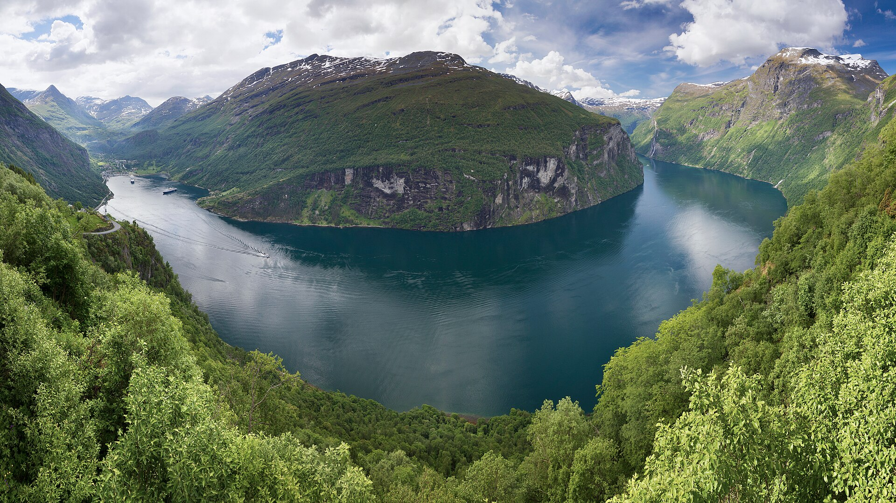
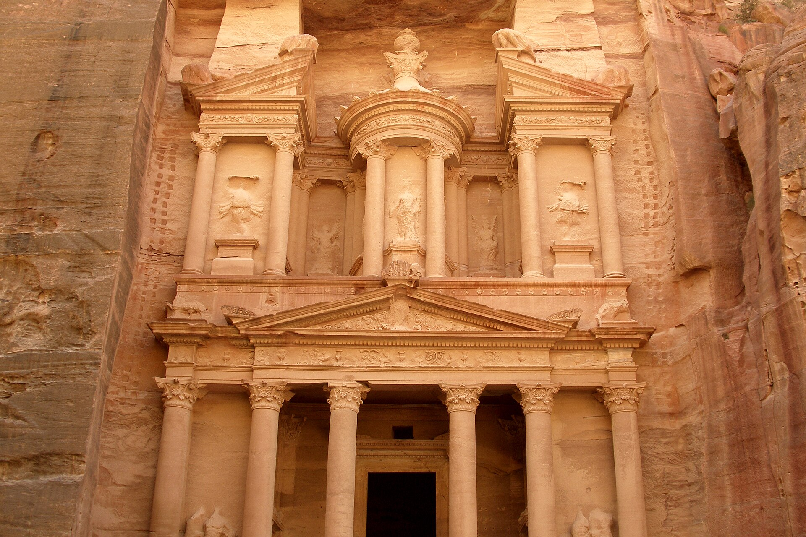
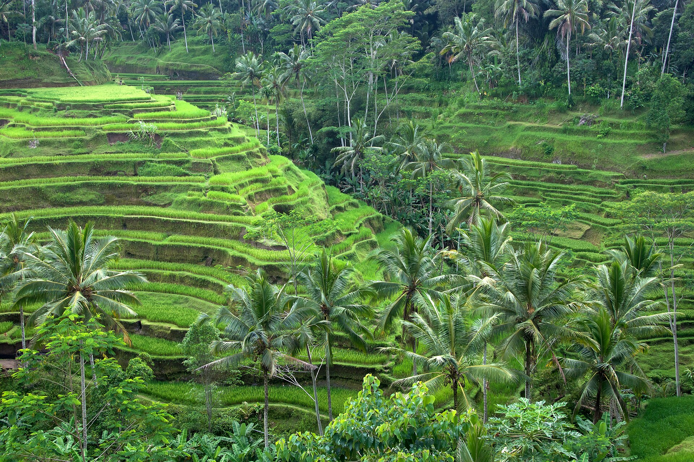

<div align="center">

# Атлас.

### Мир начинается с выбора направления

Интерактивное путешествие по Европе и Азии: от общей карты — к региону, стране, столице и её пейзажам.

**2 континента · 9 регионов · 39 стран**



</div>

## Как это работает

**Континент → регион → страна.** Карта плавно приближается к выбранному месту. На последнем шаге появляются столицы; страна открывается по контуру, подписи столицы или в списке. В карточке — фотография, флаг, герб и короткий рассказ.

Сайт сделан на **HTML, CSS и JavaScript**. Для просмотра не нужны сборка, сервер или сторонние библиотеки: изображения и данные карты находятся в репозитории.

## Внутри атласа

- **Европа:** Кавказ, Пиренейский полуостров, Центральная Европа, Славяне, Скандинавы, Балканы.
- **Азия:** Восточная Азия (включая Тайвань), Арабы (включая Палестину), Юго-Восточная Азия. В последнем регионе есть Таиланд, Индонезия, Малайзия, Сингапур, Вьетнам и Филиппины.
- **Карта:** единое полотно с границами стран, подсветкой маршрутов, плавным приближением и маркерами столиц.
- **Интерфейс:** бело-красная палитра, анимированные переходы, компактная боковая панель и адаптация под небольшой экран. Уменьшение анимации поддерживается через системную настройку `prefers-reduced-motion`.

<div align="center">
  
  
  
</div>

## Запуск

```bash
git clone https://github.com/count-rzy/nice-atlas.git
cd nice-atlas
```

Откройте `index.html` в браузере. Весь сайт работает локально, в том числе карта и фотографии.

## Структура проекта

```text
index.html          Страница и разметка карточки страны
styles.css          Оформление, адаптивная сетка и анимации
script.js           Маршруты, страны и взаимодействие с картой
map-data.js         Подготовленные контуры стран для браузера
countries.geojson   Исходные геоданные
make-map.py         Сборка map-data.js из геоданных
photos/             Фотографии, флаги, гербы и сведения об авторах
download-*.py       Скрипты обновления локальных изображений
```

Python-скрипты нужны только для обновления данных и изображений. При обычном запуске сайта они не выполняются.

## Данные и изображения

Контуры подготовлены на основе [Natural Earth 1:110m](https://www.naturalearthdata.com/downloads/110m-cultural-vectors/110m-admin-0-countries/). Для небольших Андорры и Сингапура, а также сектора Газа добавлены контуры [Natural Earth 1:50m](https://www.naturalearthdata.com/downloads/50m-cultural-vectors/50m-admin-0-countries/). В этой версии карты Сербия показана единым контуром без внутренней линии Косово. Большинство координат столиц взято из [Natural Earth Populated Places](https://www.naturalearthdata.com/downloads/110m-cultural-vectors/110m-populated-places/); Андорра-ла-Велья, Братислава и Тирана уточнены по GeoNames и UNGEGN. Для Палестины обозначен Восточный Иерусалим согласно [UNData](https://data.un.org/legacy/en/iso/ps.html), где это указано как обозначение Государства Палестина.

Фотографии и гербы хранятся локально. Авторы, лицензии и ссылки на оригиналы перечислены в [источниках фотографий](photos/CREDITS.md) и [источниках гербов](photos/coats/CREDITS.md). Как заменить изображения, описано в [папке `photos/`](photos/README.md).

## Лицензия

Код проекта распространяется по [лицензии MIT](LICENSE). У фотографий и гербов могут быть собственные условия использования — они указаны в файлах с источниками выше.
